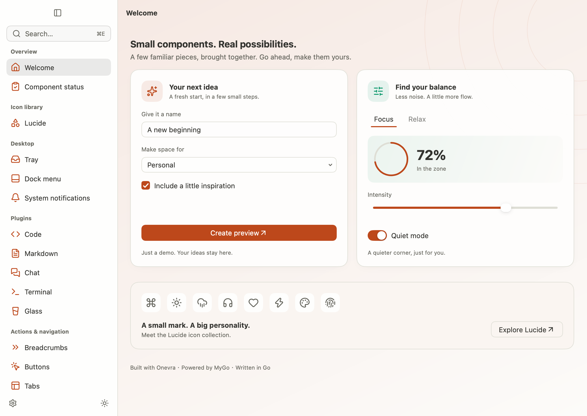

# Onevra

[English](README.md) | **简体中文**

Onevra 是基于 [MyGo](https://github.com/egoist/mygo) 的原生桌面 Go 组件库，提供主题控件、窗口 Shell、Lucide 图标和可复用插件。名字由 **ONEO** 中的 `One` 与自造词尾 `vra` 组合而成。



## 补充组件

在 MyGo 官方提供的原生 UI 能力之上，Onevra 重点补充面向应用场景的组合组件：

- **对话界面**：将消息轮次、工具执行过程、折叠摘要和附件输入组合成完整的聊天界面。
- **WebView 混合渲染**：将网页内容与 MyGo 原生组件组合在同一界面中，让按钮、浮层和对话框等组件显示在浏览器内容上方，不被 WebView 遮挡。目前位于需要 MyGo 补丁的 `neorio/webview` 实验分支。
- **Markdown 渲染**：提供可选择文本的文档视图，支持代码高亮、图片及自定义代码块内容。
- **代码高亮**：提供适配浅深色主题的只读代码视图，可独立使用，也可用于 Markdown 和对话内容。

- **Lucide 图标**：提供可直接用于 MyGo 的 SVG 图标，通过具名函数按需加载，支持尺寸设置与文字颜色继承。

## 示例程序

开发环境与系统依赖遵循 [MyGo 官方要求](https://mygo.egoist.dev/docs)。

从仓库根目录启动可交互的 Gallery：

```sh
cd source
go run ./examples/gallery
```

追加 `-theme light` 或 `-theme dark` 可预览指定外观。另外提供三个小型应用，在 `source/` 中运行：

| 示例 | 用途 | 命令 |
| --- | --- | --- |
| Desktop | 带设置界面的主窗口应用 | `go run ./examples/desktop` |
| Menu bar | 带便笺面板的托盘应用 | `go run ./examples/menubar` |
| Hybrid | 主窗口与托盘组合，可选后台启动 | `go run ./examples/hybrid` |

每个模板都包含多语言、偏好设置及独立打包配置，复制与修改方式见[应用模板](docs/build.md#starter-applications)。Windows 和 Linux 仍需各自的[原生界面验证](docs/build.md#native-review)。

## 开发者入门

发布前，使用包含你的应用模块和本仓库 `source/` 目录的本地 Go workspace，不要提交机器相关的工作区文件。**首个版本发布后**，可在应用模块中安装：

```sh
go get github.com/oneo-me/onevra/source@v0.2026.1
```

将以下最小应用保存为 `main.go`，在应用模块中执行 `go run .`：

```go
package main

import (
    "log"

    "github.com/egoist/mygo"
    "github.com/egoist/mygo/ui"
    "github.com/oneo-me/onevra/source/components"
    "github.com/oneo-me/onevra/source/shells/plain"
)

func main() {
    mygo.App.WhenReady(func() {
        shell := plain.NewShell(plain.ShellOptions{
            Title: "Hello Onevra",
            Content: func(c *ui.Context) {
                ui.Column(c).Fill().Padding(24).Children(func() {
                    components.Text(c, "Hello, Onevra!")
                })
            },
        })
        shell.Window().OnClosed(func() { mygo.App.Quit() })
    })
    if err := mygo.App.Run(); err != nil {
        log.Fatal(err)
    }
}
```

在 MyGo 就绪后创建窗口，用 Onevra 控件和 MyGo 布局原语构建内容；状态、持久化和异步任务由应用管理。

## Packer

Onevra 单独提供 [Packer](source/tools/packer/main.go)，可替代 MyGo 官方打包命令。它读取 `packer.yaml`，生成包含图标、资源和插件原生库的应用包；应用无需使用 Onevra 组件也可以使用 Packer。

在 `source/` 中运行或打包 Gallery：

```sh
go run ./tools/packer run
go run ./tools/packer build
```

`run` 编译并启动当前平台的应用；`build` 按配置的目标生成归档。用于其他项目时，在 `source/` 执行 `go install ./tools/packer`，将 Go 的二进制安装目录加入 `PATH`，然后在目标项目的 `packer.yaml` 所在目录执行 `packer run` 或 `packer build`。

支持 macOS DMG/ZIP、Windows ZIP 和 Linux tar.gz。macOS 打包需要 Mac；面向分发的签名与公证需另行处理。详见[打包配置与要求](docs/build.md#app-bundles)。

## Shells

Shell 负责创建原生窗口并应用 Onevra 主题，应用生命周期和业务状态由调用方管理。

| 包 | 布局 |
| --- | --- |
| [`shells/plain`](source/shells/plain/shell.go) | 单内容区，自动避让窗口控制区；上方最小示例使用此布局 |
| [`shells/sidebar`](source/shells/sidebar/shell.go) | 可折叠、可调整宽度的侧栏与内容区，支持标题栏操作及页面替换 |

通过 `github.com/oneo-me/onevra/source/` 下的对应路径导入。两者均通过 [theme 包](source/theme/doc.go) 支持跟随系统、浅色和深色外观。Sidebar 内容需要避让悬浮标题栏时，使用 `sidebar.HeaderHeight(c)`，详见[布局说明](docs/architecture/components.md#page-container-and-layout)。

## 图标

[Lucide 包](source/icons/lucide/doc.go) 提供具名 SVG 访问函数。导入 `github.com/oneo-me/onevra/source/icons/lucide` 和 `components`，在内容构建函数中使用：

```go
components.Icon(c, lucide.Search).Size(20, 20)
```

图标首次使用时解析，之后复用，并继承文字颜色。Icon 组件也接受已解析的 MyGo SVG。

## 组件

导入 `github.com/oneo-me/onevra/source/components` 使用带主题的输入、选择、导航、集合与浮层组件。在内容构建函数中使用由应用持有的 `agreed`、`wifi` 等状态：

```go
if components.Button(c, "Save", components.ButtonPrimary).Clicked() {
    // Save application state.
}
components.Checkbox(c, &agreed, "I agree")
components.Switch(c, &wifi, "Wi-Fi")
```

宿主应用 Onevra 主题后，组件也可脱离 Shell 独立使用。参见[组件契约](source/components/doc.go)和[主题用法](source/theme/doc.go)。独立的[插件](docs/architecture/components.md#plugin-composition)提供命令面板、语法高亮、Markdown 和会话视图。

## 参与开发

修改前阅读 [AGENTS.md](AGENTS.md) 和[架构概览](ARCHITECTURE.md)。在 `source/` 中运行：

```sh
gofmt -l .
GOWORK=off go test ./...
GOWORK=off go test -race ./...
GOWORK=off go vet ./...
GOWORK=off go build ./...
```

格式检查应无输出，完整验证要求见[开发检查](docs/build.md#development-checks)和[原生界面检查](docs/build.md#native-review)。保持中英文 README 内容一致，并将面向使用者的变化记录到 [CHANGELOG.md](CHANGELOG.md)。版本规则与发布流程见[发布说明](docs/build.md#publication)。

## 协议

项目代码采用 [MIT](LICENSE) 协议。改编自 MyGo 的控件保留[上游 MIT 声明](source/components/LICENSE.mygo)。Lucide 资源保留[上游 ISC 和 Feather MIT 声明](source/icons/lucide/LICENSE)。
